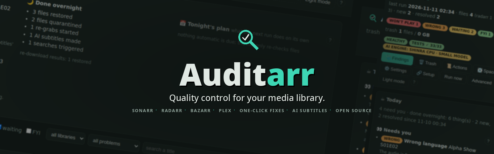
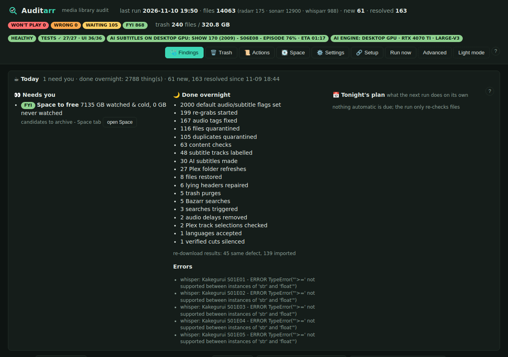
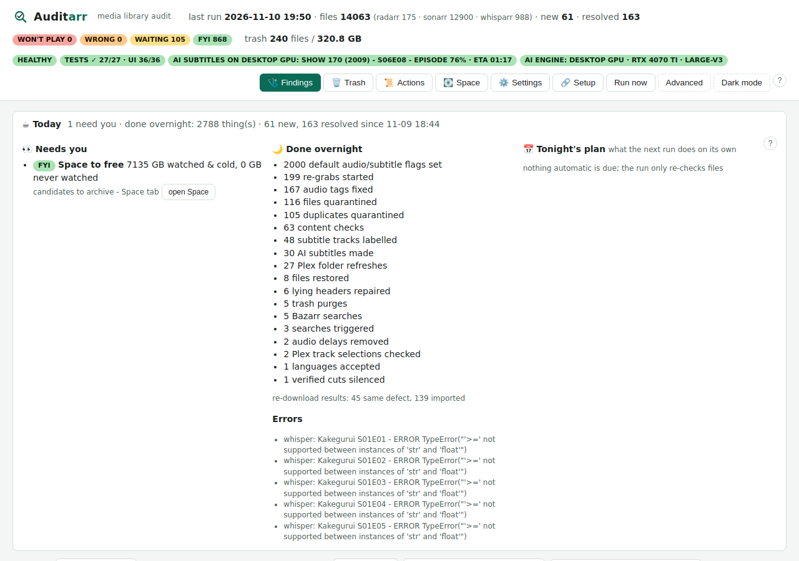
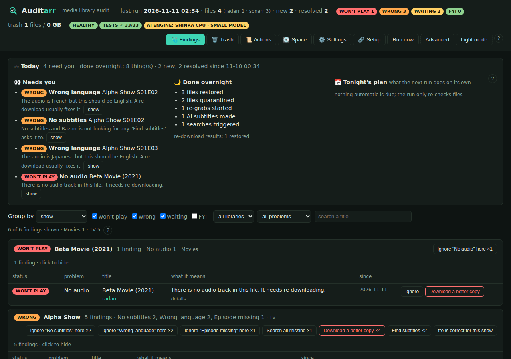
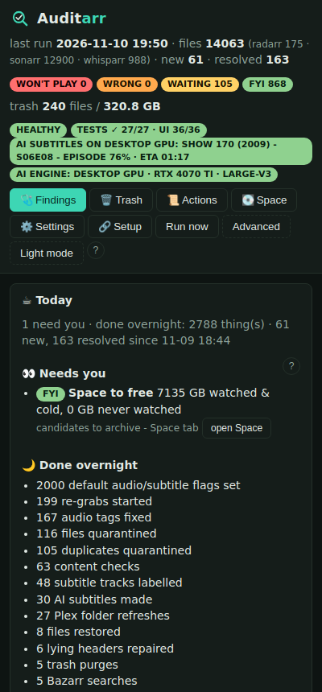

# 🔍 Auditarr



[](https://github.com/chrizantoz/auditarr/actions/workflows/ci.yml) [](https://github.com/chrizantoz/auditarr/releases) [](LICENSE) [](docs/INSTALL.md) [](https://chrizantoz.github.io/auditarr/) [](https://github.com/chrizantoz/auditarr/pkgs/container/auditarr)

**Auditarr is a nightly quality-control bot for a self-hosted media library.** If you run the "arr" apps — **Sonarr** (TV), **Radarr** (movies), **Whisparr** (adult), **Bazarr** (subtitles) — alongside **Plex**, Auditarr opens every media file, checks what is *actually* inside it against what those apps *believe* is there, quietly fixes the safe problems on its own, and leaves you one-click, undoable buttons for the rest.

Think of it as a librarian that walks the shelves each night: it finds the mislabeled, the broken, the wrong-language and the missing — then either fixes them or hands you a tidy to-do list.

- 🧪 **Try it in your browser:** a demo with sample data (actions simulated) is built on every release by `uibot/make_demo.py`; it is published at https://chrizantoz.github.io/auditarr/ once the repository is public.
- 📘 **New here? Start with the [User guide](docs/USER-GUIDE.md)** — a plain-language tour of the page and every button.
- 📋 **Everything it checks and every button it has:** [FEATURES.md](FEATURES.md)
- 📰 **What changed and when:** [CHANGELOG.md](CHANGELOG.md)
- 🗺️ **Where it is going:** [ROADMAP.md](ROADMAP.md) · 📦 **Installing step by step:** [docs/INSTALL.md](docs/INSTALL.md)

It is deliberately small: one Python file, one HTML page, a local SQLite file for its state, and no separate database server. It runs as a single Docker container.

## 🚧 Status

Beta. Auditarr was built for one homelab (about 14,000 files across Sonarr, Radarr, Whisparr, Bazarr and Plex on Unraid) and then generalized: the Setup tab, the install docs and the test suites exist so that a second person can run it. Expect rough edges around setups that differ from that one (other players, other path layouts, no Plex). Issues with a copy of the Live tab's log lines are welcome.

## 🖼️ Screenshots

Taken by the test bot in CI from real (sanitised) data, so they are always current.

| Findings, dark | Findings, light |
|---|---|
|  |  |

| A small test library with one of each problem | On a phone |
|---|---|
|  |  |

## 🧰 What you'll need

- The arr apps and/or Plex you already run. You don't need all of them — Auditarr uses whichever it can reach.
- Your media visible to Auditarr at the **same path** the other apps use (mounted at `/data` below). If the paths differ, you can map them — see *Requirements*.
- About five minutes to fill in the `docker run` command below.

### How it works in three steps

1. 🔗 **Connect** — start the container, open the page, paste your Sonarr / Radarr / Bazarr / Plex addresses and keys on the **Setup** tab and press *Test*.
2. 🌙 **It audits every night** — opens every file, finds what is wrong, fixes the safe things by itself, and sends you one morning message: *Needs you: …*
3. 🔘 **You press a button** — every problem has one plain-language sentence and one verb button (*Download a better copy*, *Make AI subtitles*, …). Everything is reversible from the **Trash** tab.

### What it runs on

Inside the container: Python 3.12 and its standard library, one Python package (`pyyaml`, to read Bazarr's config), `ffmpeg`/`ffprobe` and `mkvtoolnix`. No database server, no framework. The test bots need Node 20 with `jsdom`, `playwright`, `axe-core`, `pixelmatch` and `pngjs` (see `uibot/package.json`); none of that ships in the app image.

## 🚀 Quick start (Docker)

The short way: run the container with your media mounted, open the page, and follow the **Setup** tab. It asks for the Sonarr, Radarr, Bazarr and Plex addresses and API keys, tests each one, shows which media folders it can see, and starts the first audit.

```bash
docker run -d --name auditarr --restart unless-stopped -p 3091:3091 \
  -e TZ=America/Winnipeg -v /path/to/appdata/auditarr:/config -v /path/to/media:/data/media \
  ghcr.io/chrizantoz/auditarr:latest
```

Step-by-step for Unraid and docker compose, including where to find the keys: [docs/INSTALL.md](docs/INSTALL.md). A compose file is in [docs/docker-compose.yml](docs/docker-compose.yml), an Unraid template in [docs/unraid-template.xml](docs/unraid-template.xml).

The mounts below are the hands-off alternative: keys are read from the apps' own config files and nothing has to be typed.

```bash
docker run -d --name auditarr --restart unless-stopped -p 3091:3091 \
  -e TZ=America/Winnipeg -e HOST_IP=192.168.1.10 -e RUN_AT=05:00 \
  -v /path/to/appdata/auditarr:/config \
  -v /path/to/media:/data \
  -v /path/to/sonarr/config.xml:/arr/sonarr.xml:ro \
  -v /path/to/radarr/config.xml:/arr/radarr.xml:ro \
  -v /path/to/bazarr/config/config.yaml:/arr/bazarr.yaml:ro \
  -v /path/to/plex/Preferences.xml:/arr/plex.xml:ro \
  ghcr.io/chrizantoz/auditarr:latest
```

Open `http://host:3091`. The **first run reads every file once** (roughly 25 minutes per 10,000 files) to learn your library; after that it only re-checks what changed, so nightly runs take a couple of minutes.

📁 **Requirements:** Auditarr, the arrs, Bazarr and Plex must all see the media at the same path (`/data` here). If they don't, add a mapping such as `PLEX_PATH_MAP=/data/media=/data`. API keys are picked up automatically from the read-only config files you mount above; or set them yourself (`SONARR_APIKEY`, etc.).

➕ **Optional extras:** Tautulli for watch stats (`-v /path/to/tautulli/config.ini:/arr/tautulli.ini:ro`, powers the **Space** tab), `NTFY_URL` (+ `NTFY_TOKEN_FILE`) for phone notifications, `SUBGEN_URLS` for AI-subtitle (Whisper) servers, a Docker socket proxy at `DOCKER_API` for live subtitle-generation progress, and `PAPERCLIP_*` to hand findings to an agent. An Unraid template is in `docs/unraid-template.xml`.

## 🔒 Who can open the page

Out of the box the page is open to your local network (handy at home). On the **Setup** tab, step 4 turns on a built-in sign-in: a user and password stored hashed in Auditarr's own database, a session cookie, and a plain login page. `/health` and the import webhook (token-protected) stay reachable for monitoring and for Sonarr/Radarr. If you already protect it with a reverse proxy that sets `Remote-User` (Authelia, Authentik), set `TRUST_PROXY_AUTH=1` and that header counts as a sign-in. Forgot the password: start once with `AUTH_USER`, `AUTH_PASSWORD` and `AUTH_RESET=1`. A second, **read-only login** for family is one step further down the same page: it sees everything and can change nothing.

## 🛡️ Is it safe? (yes — nothing is deleted outright)

- **It starts cautious.** Every action that writes or deletes is a switch set to `off`, `dryrun` (show me what it *would* do, change nothing) or `on`. Out of the box, anything that removes a file is in dry-run. The switches: `ARR_RESCAN`, `DEDUPE`, `REMEDIATE` (deleting re-downloads also needs `REMEDIATE_CONFIRM=I_UNDERSTAND_FILES_WILL_BE_DELETED`), `SUBTAG`, `AUTO_FIXHEADER`, `AUTO_VERIFY`, `TRACK_PREFS`, `PLEX_REFRESH`. (`JOBS=off` lets a container note the jobs it *would* run without running them — used for the staging copy.)
- **Nothing is deleted directly.** Files are moved to a Trash folder and only purged after a grace period: duplicates after 3 days (`TRASH_DAYS_DEDUPE`), re-downloads after 14 (`TRASH_DAYS`), archives after 30 (`TRASH_DAYS_ARCHIVE`). The **Trash tab restores anything with one click.**
- **Repairs are lossless.** When it fixes a broken file header or audio that's out of sync, it rebuilds the file without re-encoding (a "remux") and verifies the new copy before the original is swapped out.
- **Who can press the buttons:** the web UI only accepts changes from a private network, or from a user your reverse proxy has already logged in (Authelia-style `Remote-User`).

## ⚙️ Settings

Every option has a sensible default and can be changed on the **Settings tab** (saved in the database — no file editing needed). If the same option is set in more than one place, this is the order that wins: a one-off `?KEY=` in the URL → what you saved in the UI → the container's environment variable → the built-in default. The Settings tab shows you where each current value is coming from.

## 🧑‍💻 For developers

🧪 **Testing** (full write-up: [docs/TESTING.md](docs/TESTING.md))
- `GET /api/selftest` runs the in-container test suite (detector sampling + reversible API checks); it also runs automatically after every nightly audit.
- `uibot/` is a headless browser bot (jsdom): `cd uibot && npm install jsdom && node ui_bot.js ../ui.html fixtures`, plus a real-browser run (`browser_bot.js`, Playwright). The published `ghcr.io/chrizantoz/auditarr-uibot` image is that bot packaged to run nightly against your own instance — **optional**; the app itself is `ghcr.io/chrizantoz/auditarr` alone.
- CI runs both on every push and publishes the images. `docs/auditarr-deploy.sh` stages a new image against a *copy* of the database before promoting it.

🗂️ **Project layout**

```
audit.py        the whole backend (checks, actions, scheduler, HTTP API)
ui.html         the whole UI
tests/          self-test, API smoke suites, diagnostics
uibot/          headless UI bot + Dockerfile + fixtures
docs/           Unraid template, deploy/staging script, homelab notes
```

Built for a single homelab; shared as-is. Issues and ideas welcome.

## ☕ Support

Auditarr is free and stays free. If it saved you an evening, a tip helps pay for the GPU time and test hardware behind the next release.

[](https://github.com/sponsors/chrizantoz) [](https://ko-fi.com/chrizantoz)

## 📄 License

GPL-3.0. Use it, change it, share it; anything you distribute based on it must stay open under the same terms. See [LICENSE](LICENSE).
